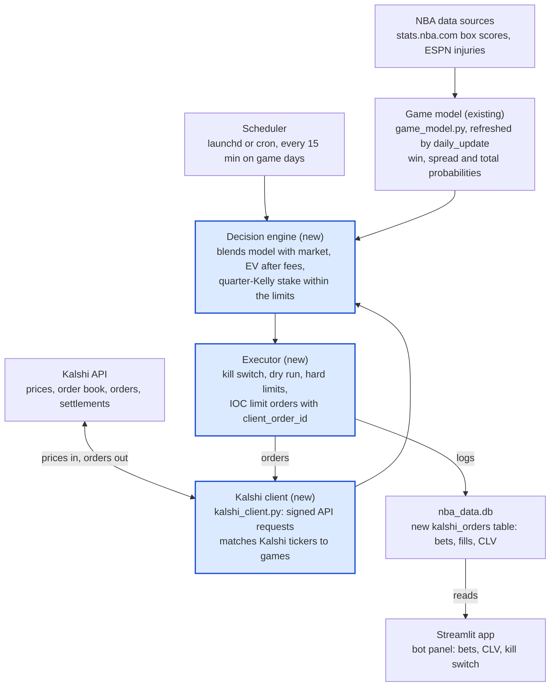
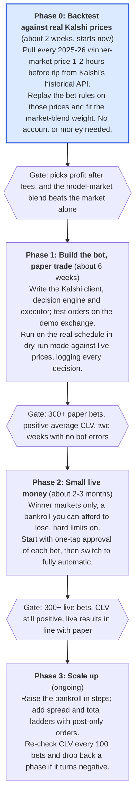

# Kalshi Auto-Betting Plan for NBA Games

As of 2026-10-26 · Living version: [Claude doc](https://claude.ai/artifact/Mewo1wTYoNaK8x1jNy8BDj)

## Goal and scope

Build a bot that reads Kalshi's prices on NBA games, compares them with the game model's probabilities, and buys contracts only when the edge clears fees and a safety margin. It reuses the existing game model (`game_model.py`) and adds three things: a Kalshi client, a decision engine and an order executor.

- **In scope:** NBA game markets on Kalshi: winner first, then spreads and totals if Kalshi lists them with enough liquidity.
- **Out of scope for now:** player props, other sports, and live (in-game) betting. The model only predicts before tip-off.
- **Success means:** after 300+ paper bets, the model beats Kalshi's closing price on average (positive closing-line value) and its probabilities are at least as well calibrated as Kalshi's. Only then does real money go in, and it scales up only if live results hold.

## Is the model ready for real money?

Not yet proven. The model is accurate and well calibrated, but nobody has measured whether it beats the market. That one test decides whether this whole project makes money.

Walk-forward backtest of the 2025-26 regular season (1,225 games, each predicted from earlier games only, run on 2026-10-26):

| Measure | Game model | What it means |
| --- | --- | --- |
| Picks the winner | 68.7% | |
| Brier score (win probability) | 0.200 | Lower is better; a coin flip is 0.250 |
| Log loss | 0.583 | |
| Margin error (average) | 11.1 pts | Naive season averages: 11.9 |
| Total error (average) | 15.1 pts | |

Calibration is good. Games the model put at 72.8% were won 73.9% of the time; at 57.5%, 57.3%.

The catch: closing betting lines for NBA winners are usually about this good too (approximate, from memory: roughly 68-70% winners and a Brier near 0.20). If the model only matches the market, it loses money once fees are paid. Profit needs games where the model is *right and the market is wrong*. That usually comes from information the market is slow on, such as a late injury, or from systematic mispricing on Kalshi specifically.

**Before any real money, the plan needs:**

1. **Historical Kalshi prices.** Re-run this backtest against what Kalshi actually charged, so we can see whether the model's +EV picks won. Kalshi's API has historical market data (next section).
2. **A paper-trading season start.** Log every decision live against real Kalshi prices for 300+ games, and measure closing-line value: did the price move toward the model after we "bet"?

## What Kalshi offers

Kalshi lists every NBA game as yes/no contracts that pay $1 if they win, priced in cents. The price is roughly the market's probability. All three markets the model predicts exist, and Kalshi's public API serves both live and past prices. Everything below was checked against Kalshi's live API on 2026-10-26 unless a source is linked.

| Market | Series | Contract example | Liquidity seen today |
| --- | --- | --- | --- |
| Winner | `KXNBAGAME` | `KXNBAGAME-26OCT26WASCHA-CHA`: "Charlotte wins", 57¢ bid / 58¢ ask | ~$330k traded on one game; 1¢ spread |
| Spread | `KXNBASPREAD` | `…-CLE21`: "Cleveland wins by over 20.5", 11¢ / 12¢ | Thin: $0 to ~$4k per line |
| Total | `KXNBATOTAL` | `…-219`: "Over 218.5 points", 77¢ / 79¢ | Thin: $0 to ~$2k per line |

Spreads and totals are ladders of many lines (one contract per point threshold), not a single line at -110. The model already gives a probability for any line, so it can price every rung.

**Fees.** Taking a price costs `ceil(0.07 × contracts × P × (1 − P))` dollars, which is at most 1.75¢ per contract, at a 50¢ price ([fee breakdown](https://www.rivermarkets.com/insights/kalshi-fees.html)). The three NBA game series carry "maker fees" too. A resting limit order that someone else fills pays a quarter of that, about 0.44¢ at 50¢ ([next.io](https://next.io/prediction-markets/kalshi/fees/)). Fees change, so read the live fee in Kalshi's order preview before going live.

**API.**

- **Prices:** public and free, no login needed: `GET /events?series_ticker=KXNBAGAME&status=open&with_nested_markets=true`.
- **Past prices:** hourly or minute candlesticks for settled games. Anything settled before 2026-08-27 (all of last season) comes from `/historical/markets/{ticker}/candlesticks`; this worked for a game on 2026-04-18. This makes a real-price backtest of last season possible.
- **Orders:** `POST /portfolio/events/orders` with `ticker`, `side` (`bid` = buy yes), `count`, `price`, `time_in_force` (`fill_or_kill`, `good_till_canceled`, `immediate_or_cancel`), optional `post_only` and `client_order_id` to stop duplicate orders ([create order](https://docs.kalshi.com/api-reference/orders/create-order-v2.md)).
- **Login:** an API key pair made in account settings. Each request is signed with the private key: Ed25519 recommended, or RSA-PSS ([API keys](https://docs.kalshi.com/getting_started/api_keys)).
- **Practice money:** a demo exchange at `https://external-api.demo.kalshi.co` with the same API and fake money.
- **Rate limits:** the basic tier allows about 10 orders a second, far more than one slate of games needs ([rate limits](https://docs.kalshi.com/getting_started/rate_limits)).

## Architecture

The bot is three new modules wrapped around the existing game model, started by a scheduler and logging to the same database the app reads.



Every 15 minutes on game days the scheduler runs the decision engine. It asks the model for tonight's probabilities and the Kalshi client for prices, picks the +EV bets, and hands them to the executor, which places them and logs everything. The app shows the log.

- **`kalshi_client.py`:** signs requests, fetches NBA events and order books, places and cancels orders, reads positions, fills and settlements. Also maps Kalshi tickers to the model's teams and dates (`KXNBAGAME-26OCT26WASCHA` = WAS at CHA on 2026-10-26).
- **`kalshi_bot.py` (decision engine + executor):** reuses `GameContext.evaluate()` and the injury handling from `app.py` (players listed Out are removed), so the bot and the app always agree.
- **Changes to existing code:** a `kalshi_orders` table in `schema.sql`, settlement in `daily_update.py`, a bot panel in the app.

## Bet decision rules

Buy a contract only when the model's probability beats Kalshi's price by more than the fee plus a safety margin, and stake a small fixed fraction of what Kelly suggests. Kalshi prices are already probabilities, so the American-odds math in `odds.py` is replaced by a simpler version.

**Expected value per contract** (buying "yes" at the ask price, fee per contract included):

```math
\text{EV} = p_{\text{model}} - \text{ask} - \text{fee}(\text{ask}), \qquad \text{fee}(P) = 0.07\,P\,(1-P)
```

Buying "no" is the same calculation with 1 − p and the "no" ask. Example from tonight: the app gives Charlotte 66% against Washington and Kalshi asks 58¢. The fee is 1.7¢, so EV = 66 − 58 − 1.7 = **+6.3¢ per $0.58 staked (+11%)**.

**Rules the decision engine applies, in order:**

1. **Blend toward the market.** Use `p = w × p_model + (1 − w) × p_market`, with `w` fit in the historical backtest. The market already knows things the model doesn't, and a raw model probability overstates the edge. Start at w = 0.5 until the backtest says otherwise.
2. **Minimum edge.** Bet only when EV is at least 3¢ per contract *and* 5% of the price. Thin edges disappear inside model error.
3. **Skip big disagreements.** If the model and market differ by more than 10 points, don't bet automatically; flag it for a human. It almost always means injury news the model hasn't seen (the app already warns at this level).
4. **Fresh inputs only.** Skip a game if the injury report or the model's data is more than a few hours old, or if a star's status changed since the last run.
5. **One side per game per market.** Never hold both sides; never add to a position just because the price moved further.

**Stake size.** For a $1 contract bought at price `a`, full Kelly is `(p − a) / (1 − a)` of the bankroll. Use **¼ Kelly** (as the app does today), then cap it:

| Limit | Starting value |
| --- | --- |
| Per bet | 2% of bankroll |
| Per game (all markets) | 3% of bankroll |
| Per day (all games) | 10% of bankroll |
| Contracts per order | No more than what the order book shows at that price |

**Which markets.** Winner markets first: they're liquid (1¢ spreads, six-figure volume). Spread and total ladders are thin, so a $50 order would move them. Add them later with post-only limit orders (lower maker fee) once the winner bot works.

## Order execution and safety controls

The bot places limit orders only, never pays more than the price it decided on, and stops itself when anything looks wrong. A bug that bets real money repeatedly is the biggest risk in this project, bigger than a bad model.

**How an order is placed:**

1. Re-read the order book right before sending. If the ask moved and the bet no longer passes the rules, drop it.
2. Send a limit order at the decided price with `immediate_or_cancel`, so it fills what it can at that price or better and never rests on the book unattended. (Later, for thin spread/total ladders: `post_only` resting orders with an `expiration_time` before tip-off.)
3. Give every order a `client_order_id` built from game + market + side + date. If the bot crashes and retries, Kalshi rejects the duplicate instead of placing it twice.
4. Record the order, the fill and the price in the database *before* moving to the next game.

**Safety controls:**

- **Kill switch.** One setting (`KALSHI_TRADING=off`, plus a button in the app) stops all new orders immediately. Default is off.
- **Dry-run mode.** The same code path does everything except send the order. Paper trading and testing use this.
- **Hard limits in code**, separate from the staking rules: max dollars per order, per game and per day, and max number of orders per day. Hitting any limit stops the bot for the day.
- **Position check.** Before each order, read the actual positions from Kalshi (`GET /portfolio/positions`), not just the local database, so a missed record can't lead to double betting.
- **Balance floor.** Stop if the account balance falls below a set amount (for example, 70% of the starting bankroll) until a human resets it.
- **Timing window.** Only trade between the injury report's last update and about 30 minutes before tip-off. No orders once a game starts.
- **Fail closed.** Any API error, missing data or unexpected response means "no bet", never a retry loop.
- **Alerts.** A notification (email or phone) for every order placed, every limit hit and every error.
- **Keys.** The Kalshi private key stays in a file outside the repo, never committed, read only by the bot. Use a key that's only for this bot so it can be revoked.

## Tracking and evaluation

Every decision is logged, including the games it passed on, and graded against Kalshi's price at tip-off. Closing-line value is the early signal; profit is the slow, noisy one.

**What gets logged per game and market** (new `kalshi_orders` table, next to the existing `game_log`):

- Kalshi ticker, side, model probability, blended probability, bid/ask at decision time, EV, stake, and why it was bet or skipped
- Order id, `client_order_id`, filled count, average fill price, fee paid
- Kalshi's last price before tip-off (the closing price) and the final result and payout

**Settling.** Kalshi settles winner markets about a minute after the final buzzer. The existing `daily_update.py` run reads settlements and fills (`GET /portfolio/settlements`, `/portfolio/fills`) and marks each bet won or lost, the way tracked bets settle today.

**The numbers that decide whether to keep going** (a new panel on the Tracked bets tab):

| Measure | Why it matters | Good sign |
| --- | --- | --- |
| Average CLV (closing price − fill price on our side) | Shows edge after a few hundred bets; profit needs thousands | Positive, consistently |
| Model vs Kalshi Brier score, on all games | Is the model better calibrated than the market? | Model lower |
| Profit and ROI after fees | The real result | Positive, but noisy for months |
| Hit rate by EV bucket | Do bigger edges actually win more often? | Rises with EV |

Review after every 100 bets. If CLV is negative after 300, stop and rethink the model rather than raising stakes.

## Rollout

Start with a backtest on last season's real Kalshi prices: it costs nothing, needs no account, and answers whether the model has an edge before any bot code is written. Each gate must pass before the next phase starts; durations are estimates.



If Phase 0 fails its gate, the next step is improving the model (late injury news, the market-blend weight), not building the bot.

## Risks, legal status and open questions

The biggest risks are that the model has no real edge over Kalshi's prices, and that Kalshi's sports markets become unavailable where you live. Both should be checked before writing much code.

| Risk | What could happen | Mitigation |
| --- | --- | --- |
| No edge | Model matches the market, so fees turn every bet into a slow loss | Historical backtest and paper trading gate real money (rollout) |
| Late news | A star is ruled out after the bot bets; the market moves, the model didn't | Trade close to tip-off, re-check injuries, skip big disagreements |
| Software bug | Duplicate or oversized orders | Dry run, hard limits, `client_order_id`, position check, kill switch |
| Legal or access change | Sports contracts geofenced in your state, or shut down | Check before funding; keep the bankroll small |
| Data outage | stats.nba.com or the injury feed fails | Fail closed: no fresh data, no bets |
| Thin markets | Orders on spread/total ladders move the price against you | Winner markets first; size to the visible order book |

**Legal status is unsettled as of October 2026.** Federal appeals courts are split on whether states can regulate Kalshi's sports contracts:

- The Third Circuit sided with Kalshi in April 2026 ([Holland & Knight](https://www.hklaw.com/en/insights/publications/2026/04/federal-appeals-court-cftc-jurisdiction-over-sports-event-contracts)).
- The Ninth Circuit (Nevada) and Sixth Circuit (Ohio, Tennessee) ruled that states can apply their gambling laws ([CNBC](https://www.cnbc.com/2026/09/25/appeals-court-rules-states-can-regulate-sports-prediction-markets.html), [Tennessee Lookout](https://tennesseelookout.com/2026/09/28/federal-court-rules-kalshi-is-subject-to-tennessees-gambling-laws-for-sports-contracts/)).
- New Jersey has asked the Supreme Court to decide ([Startup Fortune](https://startupfortune.com/new-jersey-asks-supreme-court-to-decide-if-kalshi-answers-to-states/)). Kalshi has reportedly already geofenced sports contracts in Nevada.

This is not legal advice. Confirm sports trading works for your account in your state, and check Kalshi's terms on automated trading through the API, before funding the bot. Winnings are taxable; Kalshi reports them.

**Open questions:**

- [ ] Which state will the account be in, and are NBA game contracts available there?
- [ ] Starting bankroll for the live phase, and the most you're willing to lose before stopping?
- [ ] Where will the bot run: your Mac on a schedule (only works when it's awake) or a small always-on server? stats.nba.com blocks most cloud servers, so a server needs another data source.
- [ ] Fully automatic, or approve each bet with one tap at first?
- [ ] Winner markets only, or spreads and totals in the first live phase too?
- [ ] Market-blend weight: start at 50/50 model and market until the backtest fits it, or trust the model's raw numbers?
